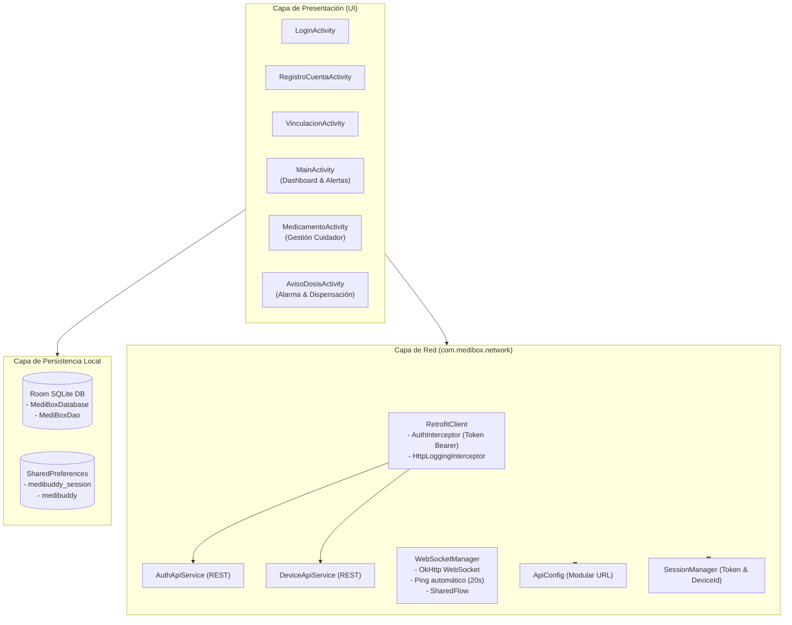

# MediBuddy - Aplicación Móvil Android

Aplicación móvil nativa en **Kotlin** para Android diseñada para acompañar a pacientes adultos mayores y a sus cuidadores en el cumplimiento de su tratamiento médico, integrándose en tiempo real mediante **REST** y **WebSockets** con la API de MediBuddy y el pastillero inteligente **ESP-32**.

---

## 📱 Características Principales

- **Perfiles Diferenciados por Rol**:
  - **Cuidador**: Programa medicamentos, ajusta dosis y horarios, genera códigos de vinculación de 6 dígitos y recibe alertas en tiempo real (batería baja del pastillero, confirmación de tomas).
  - **Adulto Mayor (Paciente)**: Interfaz intuitiva y accesible con botones grandes, confirmación rápida de tomas, aviso sonoro/visual y vinculación sencilla con su cuidador mediante código.
- **Comunicación en Tiempo Real (WebSocket)**:
  - Escucha reactiva en segundo plano con `OkHttp WebSocket` y `Kotlin Coroutines (SharedFlow)`.
  - Notificaciones instantáneas de eventos físicos: cuando el paciente abre la tapa o presiona el botón físico del pastillero.
- **Conectividad REST Asíncrona (Retrofit 2)**:
  - Autenticación segura mediante tokens de sesión y headers `Authorization: Bearer`.
  - Sincronización automática de medicamentos y programación médica.
  - Envío de comandos directos al hardware (ej. botón *"Dispensar"* que activa el servomotor del ESP-32).
- **Almacenamiento Local Híbrido**:
  - Persistencia local con **Room Database** y **SharedPreferences** para permitir funcionamiento offline si se pierde la conexión de red.
- **Configuración Modular sin Hardcoding**:
  - URLs base inyectadas desde variables de entorno de compilación o modificables en tiempo de ejecución.

---

## 🏗️ Arquitectura de la Aplicación



---

## 📂 Estructura del Código Fuente

```text
MediBuddy/app/src/main/java/com/medibox/
├── data/
│   ├── datos/               # DAO de Room (MediBoxDao)
│   ├── modelo/              # Entidades Room (AdultoMayor, Cuidador, Medicamento, Toma)
│   └── repositorio/         # Repositorios de datos locales
├── network/
│   ├── api/
│   │   ├── AuthApiService.kt      # Endpoints REST de registro, login y vinculación
│   │   └── DeviceApiService.kt    # Endpoints REST de medicamentos y comandos IoT
│   ├── model/
│   │   └── NetworkModels.kt       # DTOs para serialización JSON con Gson
│   ├── ApiConfig.kt         # Gestión modular de URLs (BuildConfig / Runtime)
│   ├── RetrofitClient.kt    # Proveedor singleton de Retrofit y OkHttpClient
│   ├── SessionManager.kt    # Almacenamiento seguro de token, rol y deviceId
│   └── WebSocketManager.kt  # Conexión WebSocket reactiva bidireccional
├── ui/
│   ├── LoginActivity.kt           # Inicio de sesión con validación en la API
│   ├── RegistroCuentaActivity.kt  # Alta de cuenta con selección de perfil
│   ├── VinculacionActivity.kt     # Código de 6 dígitos (generación/canje)
│   ├── MainActivity.kt            # Pantalla principal y escucha de alertas WS
│   ├── MedicamentoActivity.kt     # CRUD de medicamentos sincronizado con la nube
│   ├── AvisoDosisActivity.kt      # Alarma de dosis y comando para dispensar
│   └── HistorialActivity.kt       # Registro histórico de tomas
└── servicios/
    ├── AlarmaReceiver.kt    # Notificaciones y alarmas programadas del sistema
    └── SyncWorker.kt        # Tareas en segundo plano
```

---

## ⚙️ Configuración Modular de Conexión

La aplicación **no tiene URLs fijas o hardcodeadas**. La URL base se configura dinámicamente:

### 1. Variables de Entorno en Compilación
Al compilar con Gradle, puedes especificar el servidor al que se conectará:
```bash
# Apuntar a un servidor remoto en la nube o VPS:
export MEDIBUDDY_API_URL="https://tu-servidor.com/"
export MEDIBUDDY_WS_URL="wss://tu-servidor.com/ws/events"
./gradlew assembleDebug
```

### 2. Valores por Defecto (Emulador de Android Studio)
Si no se definen variables de entorno, Gradle inyecta automáticamente:
- **API REST:** `http://10.0.2.2:8080/` *(alias del localhost de tu computadora)*
- **WebSocket:** `ws://10.0.2.2:8080/ws/events`

### 3. Modificación en Tiempo de Ejecución
Desde cualquier pantalla de la aplicación puedes redirigir la conexión a una IP local (ej. para pruebas en un celular físico en la misma red Wi-Fi):
```kotlin
ApiConfig.setCustomServer(
    context = context,
    apiBaseUrl = "http://192.168.1.50:8080/",
    wsBaseUrl = "ws://192.168.1.50:8080/ws/events"
)
```

---

## 🚀 Requisitos y Pasos para Ejecutar

### Requisitos
- **Android Studio** Ladybug o superior (instalación nativa recomendada).
- **JDK:** Java 21 o Java 17.
- **Android SDK:** `compileSdk 35` (o 34), `minSdk 26` (Android 8.0 Oreo o superior).
- **Gradle:** 8.9+ (incluido en el proyecto vía `./gradlew`).

### Pasos en Android Studio
1. Clona o abre la carpeta `MediBuddy` en Android Studio:
   ```bash
   cd MediBox_MediBuddy/MediBuddy
   ```
2. Asegúrate de estar en la rama de red:
   ```bash
   git checkout feature/api-connection
   ```
3. Deja que Android Studio sincronice las dependencias del archivo `build.gradle.kts`.
4. En el **Device Manager**, inicia un emulador (por ejemplo *Pixel 8 con Android 14/15*).
5. Haz clic en **Run 'app' (Shift + F10)**.

---

## 🧪 Flujo de Pruebas en la App

1. **Inicio de Sesión**:
   - Ingresa con una cuenta registrada previamente en la API (ejemplo: `cuidadora@test.com` y `password123`).
2. **Consultar Medicamentos**:
   - Entra en la pestaña **Medicina**. Verás la información descargada directamente de la base de datos PostgreSQL/H2 del servidor.
3. **Dispensación de Pastilla**:
   - Pulsa **Probar aviso de dosis** y luego **Dispensar**. Observa en la terminal de la API cómo se recibe la orden en tiempo real para el pastillero `ESP32_MED_01`.
4. **Recepción de Alertas en Tiempo Real**:
   - Cuando el pastillero físico o el simulador reporte `alertType: MEDICATION_TAKEN` o `LOW_BATTERY`, la app mostrará la alerta automáticamente en pantalla.

---

## 📚 Documentación Relacionada
- [GUIA_INTEGRACION_API_APP_ESP32.md](../GUIA_INTEGRACION_API_APP_ESP32.md): Manual técnico con diagramas y esquemas de tramas del ESP-32.
- [PRUEBAS_API_CURL.md](../PRUEBAS_API_CURL.md): Colección de comandos cURL para pruebas independientes.
- [REPORTE_CAMBIOS.md](../REPORTE_CAMBIOS.md): Bitácora técnica de cambios en el proyecto.
